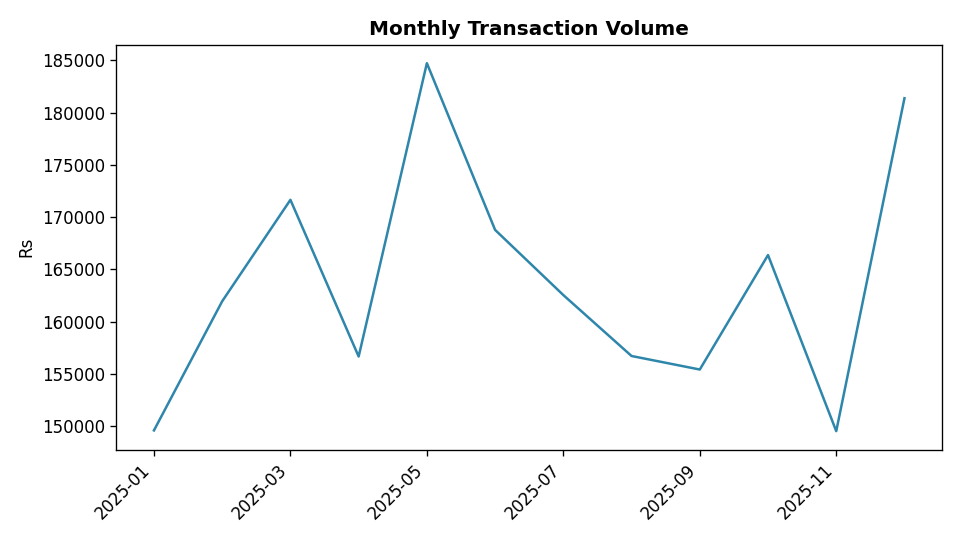
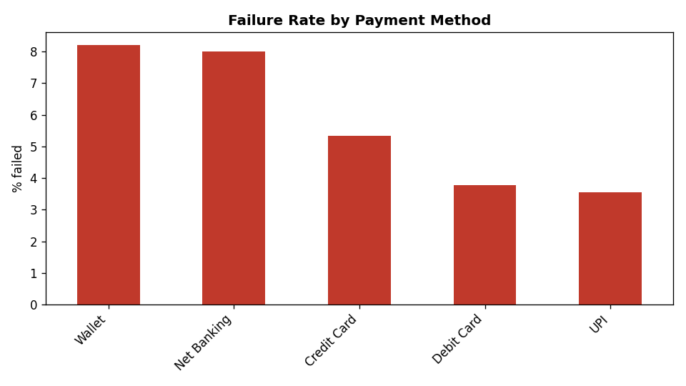

# Fintech Transactions Analysis

End-to-end data analysis project on a (synthetic) digital payments dataset, built with **Python (pandas, matplotlib)** and **SQL**.

## Business questions
1. How much transaction volume are we processing, and what is the average ticket size?
2. Which payment methods fail the most?
3. Which categories and cities drive the most volume?
4. How does volume change month over month?
5. Are there unusually large transactions worth reviewing?

## Dataset
5,000 synthetic transactions (Jan-Dec 2025) with: `transaction_id, customer_id, timestamp, amount, category, payment_method, city, status`.
The data is generated by `generate_data.py` and intentionally includes missing values and duplicates to practice data cleaning.

## Approach
1. **Clean:** removed duplicate transaction IDs, filled missing city with "Unknown", dropped rows with missing amount.
2. **KPIs:** volume and average ticket computed on successful transactions only.
3. **Analysis:** monthly trend, category/city breakdown, failure rate by payment method, top customers.
4. **Outliers:** flagged high-value transactions using the IQR method.
5. **SQL:** the same analysis in `queries.sql`, including window functions (`LAG`, `RANK`).

## Key results
- 4,975 clean transactions, failure rate **4.82%**
- Total successful volume: **Rs 19.65 lakh**, average ticket **Rs 415**
- Highest failure rate: **Wallet (8.21%)**
- Top category by volume: **Shopping**
- Peak month: **May 2025**




## How to run
```bash
pip install -r requirements.txt
python generate_data.py
python analysis.py
```

## Project structure
```
generate_data.py   # creates transactions.csv
analysis.py        # cleaning, KPIs, charts, summary.md
queries.sql        # SQL version of the analysis
images/            # generated charts
summary.md         # generated insights
```

## Possible next steps
- Build a Power BI / Tableau dashboard on `transactions.csv`
- Add customer segmentation (RFM analysis)
- Add a simple fraud-risk score
